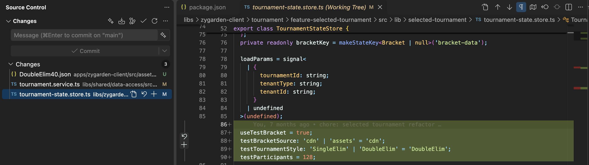
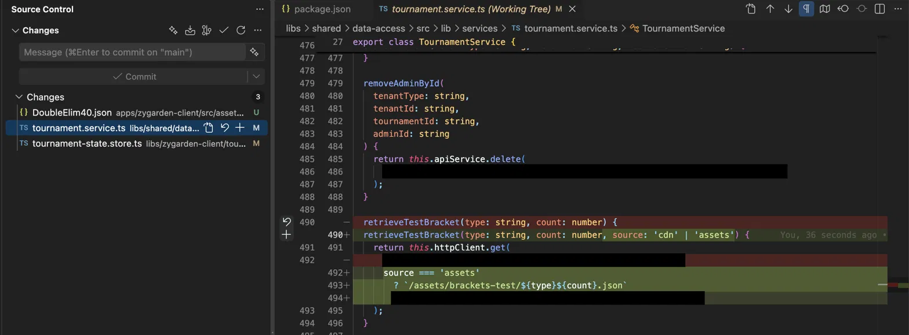

## Why I was against it

For a long time I was completely against AI, and honestly I'm still against a lot of it. It has felt like corporate greed, and it still does. It's marketed as a way to do more with fewer people, and the executives pushing it seem more interested in cutting costs than in making anything good. Then there's the slop flooding the internet, and all the terrible ways people use it. None of that has gone away. What changed is that I stopped treating the tool and the way it's sold as the same thing.

What got me to start using it was some bracket code I was building for Zygarden, a tournament platform for competitive Pokémon. I wanted to test how the app handles single and double elimination brackets at every size from 2 to 128 participants. Doing that the slow way means creating more than 250 tournaments.

I had two options in mind: make every bracket by hand, or ask AI to generate them. I thought about writing a generator, but it felt like it would take too long to build for something that was only test data, so I decided to try asking AI for help.

It didn't give me the data in the right format at first. I noticed because things looked off when I loaded it into the app, so I went through it, fixed it, and ended up with a full set of test brackets I can load whenever I want. Doing it by hand would have taken way longer, and I could check the result because I know what a correct bracket should look like.

The studies on how much time AI really saves are [mixed](https://metr.org/blog/2025-07-10-early-2025-ai-experienced-os-dev-study/). It seems to help most on well-defined, self-contained tasks, like [this one](https://arxiv.org/abs/2410.12944), and least when experts are working in code they already know well. Generating test brackets was the first kind.

Here's what the test setup looks like. A few settings in the app let me choose which bracket to load, and whether it comes from local files or a hosted copy:

It's made me better at things too. It shows me different ways of doing something, and it's great for rubber duck debugging. Explaining a bug to it often shows me the cause before it even answers.

There's an analogy I like for this. Why dig with your hands when you can use a shovel? I think it's mostly right, but the shovel isn't the whole story. The rest of this post is about where it stops working.

## The environmental impact and regulations

One could argue that the environmental cost of huge data centers is reason enough not to use AI at all. I get that, and I hate the impact too. These facilities use a lot of electricity and water, and the people who live near them feel it first. Data center electricity use is way up from a few years ago, and [that's expected to keep rising](https://www.iea.org/reports/key-questions-on-energy-and-ai/executive-summary).

These costs are real, and they hit hardest in the communities next to data centers, where water and the power grid get strained. I'm not trying to brush that off. But when I look at the big picture, AI is only part of a small share of the problem today. [All data centers together, not just AI, account for around 0.5% of global CO2 emissions](https://carbonbrief.org/ai-five-charts-that-put-data-centre-energy-use-and-emissions-into-context), while [livestock is estimated at 12-20% of global greenhouse gas emissions](https://www.climatechangenews.com/?p=52515) and [fashion at up to 8%](https://news.un.org/en/story/2025/03/1161636). That doesn't make AI's footprint okay. I'd just rather hold everything I use to the same standard than single out one thing.

So for me it isn't really about using AI or not. It's about what it costs, in energy and in what I stop learning, and what I get back. For generating test data I can check, I think it's worth it. For flooding the internet with low-effort content, I don't think it is.

I think AI use should be disclosed, and that we should stay critical of how we use it. Most of my objections come down to not knowing whether a person made something, whose work it was built on, or what it cost the environment. [California](https://www.morganlewis.com/pubs/2026/08/new-california-ai-disclosure-rules-become-operative) and [the EU](https://www.dynamisllp.com/knowledge/ai-disclosure-in-2026-recent-developments-and-practical-steps-for-brands-and-influencers) have started down this road, and both now have rules for labeling AI-generated content.

I'd also want to know what AI costs where it's built. [California](https://www.insideenergyandenvironment.com/2026/09/californias-new-data-center-package-highlights-growing-state-focus-on-energy-water-and-environmental-impacts/) and [New Jersey](https://news.bgov.com/artificial-intelligence/new-jersey-joins-states-cracking-down-on-data-center-energy-use) now require data centers to report their energy and water use, which seems like a good starting point.

## The archaeologist

Not every job needs a shovel. An archaeologist doesn't dig with one, because the careful part is the point. A brush and a trowel are slower for a reason, and breaking something to save time isn't saving anything.

This is the line I draw for myself:

- Using AI to debug a problem I understand: a shovel.
- Using AI to explore an unfamiliar area, then checking what it told me and learning it myself: a shovel.
- Using AI to produce something I don't understand and shipping it anyway: a crutch.

Code I don't understand is code I can't maintain, fix or explain, so I use AI where I could check the answer myself. If I can't tell a good hole from a bad one, I shouldn't be the one digging.

Logs are another place it helps. At work, we have a JSON column in SQL Server logging tables, and searching that when you don't know what you're looking for can take a very long time. Comparing behavior across a microservice setup is just as slow, like checking QA against UAT. This is where AI really comes in handy. I can export the logs to a file and have it read through hundreds of entries, tell me what's missing between the two environments, and point out what went wrong and when. It can miss things, so I treat what it finds as a lead and look into it myself. It helps me troubleshoot, but I still have to think about what it tells me and decide what to do about it.

Someone who read an earlier version of this post pointed out that a lot of what AI does well is the "jack of all trades" work, the shallow, dabbling kind of knowledge that used to be worth something on its own. I think that's true, and my bracket story is a good example. I only caught the bad output because I knew what a bracket should look like. If I hadn't, I'd have loaded it and trusted it, and I don't want to give up the part where I know enough to check.

Video games have a version of this that makes sense to me. In speedrunning, tool-assisted runs have to be disclosed. Using tools to learn tricks and practice is fine, and pretty much every speedrunner does it. Using them during the actual run without saying so defeats the point. People forgive a run that was disclosed, but not one that was hidden. I think AI works the same way. The tool isn't the problem, hiding it is.

## Art

There's one place I don't want the shovel at all, and that's art.

With code, the hole is usually a means to something else. With art, making it is often the whole point. When someone draws, paints or composes something, what I value is the time, the choices and the person behind it, and a generated image skips all of that.

I can't separate it from the corporate greed I mentioned at the start, either. Many artists say their work was used to train these tools without their permission, and I think that deserves to be taken seriously.

This is just my opinion, and I know plenty of people see it differently. But if something is AI-generated, I'd like to be told, same as everywhere else.

## Takeaways

So, why dig with your hands when you can use a shovel? I will, as long as I know where the hole goes and I'm honest that I used one. Here's what I try to follow:

- Use it for the slow, mechanical parts, so I have more attention left for the work that needs judgment.
- Don't use it to skip understanding. If I couldn't check the answer myself, I shouldn't trust it.
- Check what it gives me. Read it, test it, do my own research before it goes anywhere.
- Say when I've used it. Hiding it is a big deal.
- Skip it where the process is the point.